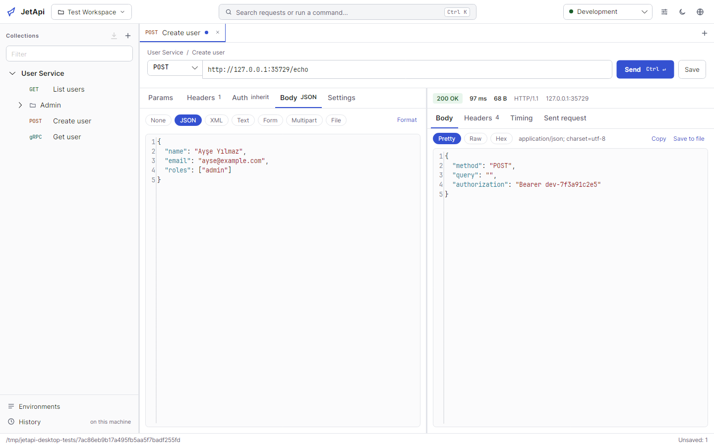
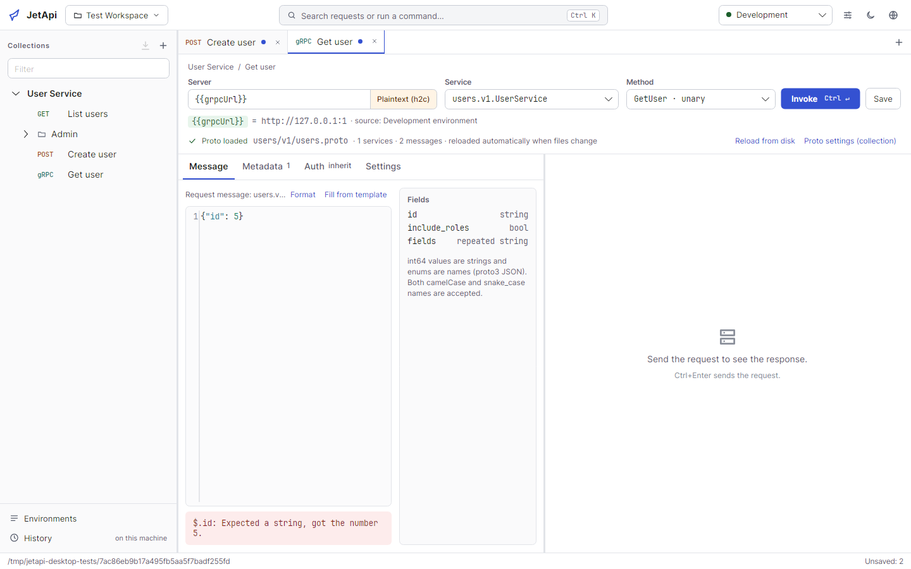
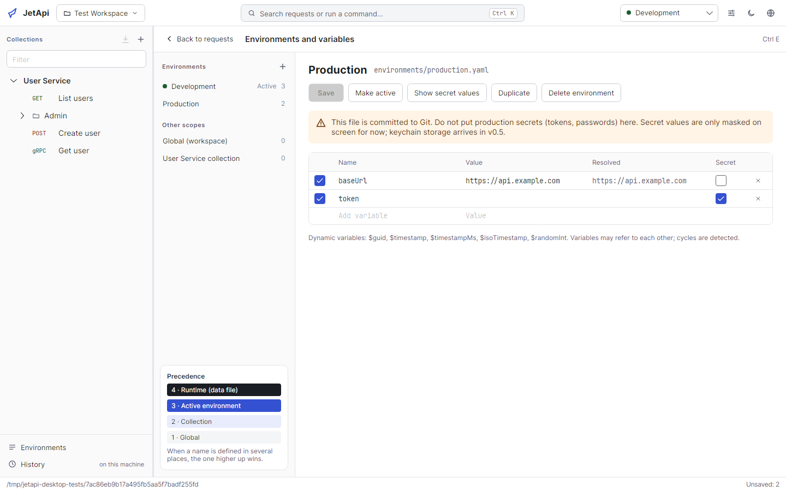
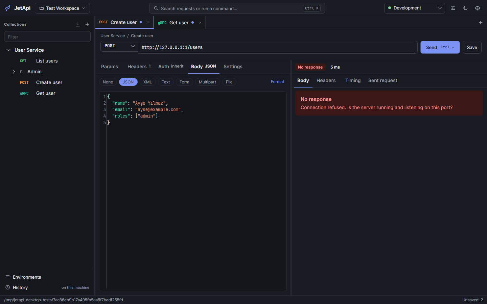

# JetApi

> A fast, local-first, Git-friendly desktop client for testing REST and gRPC APIs. Open source (MIT).

**JetApi**; geliştiricilerin ve test uzmanlarının REST ve gRPC API'lerini hızlı, doğru ve Git ile birlikte çalışarak test
ettiği, hesap gerektirmeyen bir masaüstü uygulamasıdır. Postman'e hafif ve şeffaf bir alternatif olarak tasarlanmıştır.

- **Hızlı ve hafif:** .NET 10 ve Avalonia ile native masaüstü uygulaması
- **Hesap yok, bulut yok, telemetri yok:** Veriler sizin diskinizde
- **Git dostu:** Her istek ayrı, okunabilir bir YAML dosyası; ekip paylaşımı Git ile
- **REST ve gRPC eşit:** `.proto` dosyalarından kod üretimi olmadan gRPC çağrısı
- **Doğru:** Gönderilen istek birebir gösterilir; DNS/bağlantı/ilk bayt/indirme süreleri ayrı ayrı ölçülür

> **Durum:** `v0.3.0`. REST ve unary gRPC istekleri, environment'lar, Postman ve OpenAPI içe aktarma, OAuth 2.0,
> kodsuz testler, koleksiyon çalıştırıcı ve CI için `jetapi` komut satırı aracı ([CLI](docs/cli.md)) kullanılabilir.
> Paketler [GitHub Releases](https://github.com/mehmedozdemir/JetApi/releases) sayfasındadır (henüz imzasız). Ayrıntılar
> için [yol haritasına](docs/roadmap.md) bakın.



| gRPC | Environment'lar | Koyu tema |
|---|---|---|
|  |  |  |

## Dokümantasyon

| Doküman | İçerik |
|---|---|
| [Vizyon](docs/vision.md) | Problem, ürün ilkeleri, kullanıcılar, kapsam dışı |
| [Gereksinimler](docs/requirements.md) | Önceliklendirilmiş fonksiyonel ve fonksiyonel olmayan gereksinimler |
| [Mimari](docs/architecture.md) | Projeler, bağımlılık kuralları, akışlar, test stratejisi |
| [Dosya formatı](docs/file-format.md) | Workspace'in diskteki YAML formatı |
| [Yol haritası](docs/roadmap.md) | Kilometre taşları ve sürümler |
| [Arayüz tasarımı](docs/ui-design.md) | M1 ekranları ve tasarım kararları |
| [Komut satırı](docs/cli.md) | `jetapi run`: CI'da koleksiyon çalıştırma, JUnit/HTML raporları, CI örnekleri |
| [ADR'ler](docs/adr/README.md) | Mimari karar kayıtları |

## Gereksinimler

- [.NET SDK 10.0](https://dotnet.microsoft.com/download/dotnet/10.0) (sürüm `global.json` ile sabitlenmiştir)
- Windows 10+, macOS 13+ veya Linux x64/arm64

## Hızlı başlangıç

```bash
git clone https://github.com/mehmedozdemir/JetApi.git
cd JetApi
dotnet restore JetApi.slnx
dotnet build JetApi.slnx
dotnet test --solution JetApi.slnx
dotnet run --project src/JetApi.Desktop
```

İlk açılışta **Yeni workspace** ile boş bir klasörde örnek bir workspace oluşturabilir ya da **Klasör aç** ile Git'ten
klonladığınız bir workspace'i açabilirsiniz.

### Klavye kısayolları

macOS'ta Ctrl yerine Cmd kullanılır.

| Kısayol | İşlem |
|---|---|
| Ctrl+Enter | İsteği gönder / gRPC çağır |
| Ctrl+S | Kaydet |
| Ctrl+K | Komut paleti (istek, environment, komut ara; `>` ile yalnızca komutlar) |
| Ctrl+N | Yeni HTTP isteği |
| Ctrl+E | Environment'lar |
| Ctrl+W | Sekmeyi kapat |
| Ctrl+L | URL'ye odaklan |
| Ctrl+F | Editörde ara |
| F2 / Delete | Ağaçta seçili öğeyi yeniden adlandır / sil |
| Alt+↑ / Alt+↓ | Ağaçta seçili öğeyi bir sıra yukarı / aşağı taşı (sürükle-bırak da olur) |

## Yapılandırma

Uygulama ortam değişkeni veya sır gerektirmez. Workspace'e özel tüm ayarlar workspace klasöründeki YAML dosyalarındadır
([dosya formatı](docs/file-format.md)). Makineye özel durum `.jetapi/` klasöründe tutulur ve Git'e eklenmemelidir.

## Proje yapısı

```
src/
  JetApi.Core/       Domain modeli ve değişken çözümleme (I/O yok)
  JetApi.Storage/    YAML workspace okuma/yazma
  JetApi.Http/       REST motoru
  JetApi.Grpc/       Proto yükleme, JSON↔protobuf codec, gRPC çağrısı
  JetApi.Testing/    Yanıt kontrolleri, değişken çıkarma, JSONPath, JSON Schema
  JetApi.Runner/     Koleksiyon çalıştırma (tekrar, veri dosyası) ve JUnit/HTML raporları
  JetApi.Cli/        `jetapi` komut satırı aracı (CI)
  JetApi.Desktop/    Avalonia masaüstü uygulaması (Services, ViewModels, Views, Themes, Localization)
tests/               Her proje için test projesi (xUnit v3, Microsoft Testing Platform)
docs/                Vizyon, gereksinimler, mimari, ADR'ler, yol haritası
```

## Katkı

Katkı süreci, branch stratejisi ve commit formatı için [CONTRIBUTING.md](CONTRIBUTING.md) dosyasına bakın.

## Lisans

[MIT](LICENSE)
